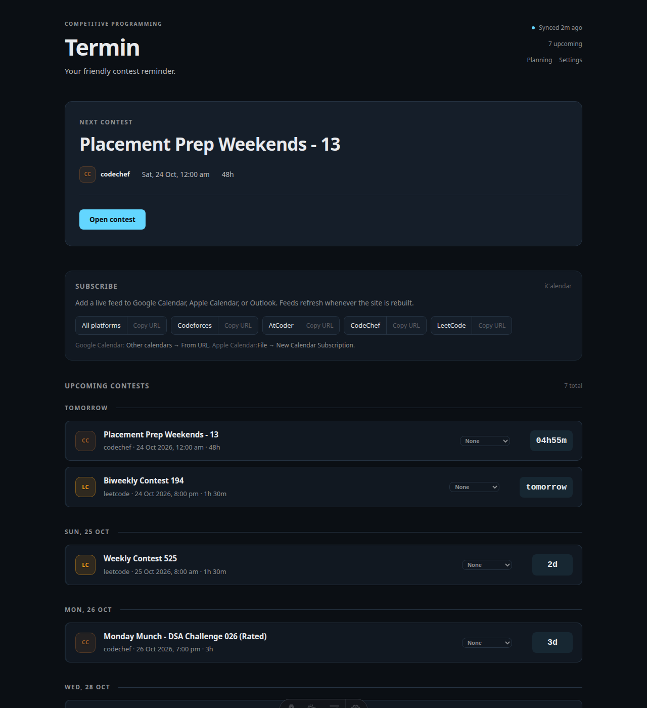

# Termin

> Every upcoming competitive programming contest in one place — plus a calendar
> feed you can subscribe to.

[](https://github.com/Dazzanova/Termin/actions/workflows/ci.yml)
[](LICENSE)




Termin pulls upcoming contests from Codeforces, AtCoder, CodeChef, and LeetCode
into a single local SQLite database. It shows what is happening next, tracks
which contests you actually joined, and publishes iCalendar feeds that Google
Calendar, Apple Calendar, and Outlook can subscribe to.

No account, no server, no telemetry — your data stays in `.data/termin.db`.

## Features

| Feature | Status |
| --- | --- |
| Aggregates Codeforces, AtCoder, CodeChef, and LeetCode | ✅ |
| Resilient sync — one failing provider never wipes the others | ✅ |
| Rejects invalid provider payloads instead of storing them | ✅ |
| Detects schedule changes between syncs | ✅ |
| Re-sync from the dashboard with the toolbar button | ✅ |
| Personal preferences: platforms, weekly cap, preferred days and hours | ✅ |
| Weekly planning with recommendations and conflict detection | ✅ |
| Participation history and behavioural insights | ✅ |
| iCalendar feeds per platform and combined | ✅ |
| Reminder delivery (push, email, Discord) | 🚧 roadmap |
| Hosted multi-user version | 🚧 roadmap |

## Quick start

Requires Node 22.12 or newer.

```bash
git clone https://github.com/Dazzanova/Termin.git
cd Termin
npm install
npm run sync   # fetch upcoming contests into SQLite
npm run dev    # http://localhost:4321
```

`npm run dev` is the full app: syncing, preferences, participation tracking, and
the calendar feeds all work. The **Sync** button in the toolbar re-fetches
contests without leaving the page. A production build (`npm run build`) is a
read-only snapshot, because the write endpoints only exist in the dev server.
See [Limitations](#limitations).

### Try the demo

```bash
npm install
npm run demo   # http://localhost:4321
```

No network, API keys, or provider sync needed. The demo seeds a disposable
database at `.data/demo.db` with upcoming contests, a week of planning
(including an overlapping pair), three weeks of history, and insights, then
starts the dev server. Your real `.data/termin.db` is never touched. The toolbar
shows a **Demo data** badge instead of **Sync**, because a fixture set is a
snapshot. Set `PORT` to use another port, and delete `.data/demo.db` when you are
done.

## Calendar subscriptions

Termin serves iCalendar feeds from these paths:

| Feed | Path |
| --- | --- |
| All enabled platforms | `/calendar.ics` |
| Codeforces | `/calendar/codeforces.ics` |
| AtCoder | `/calendar/atcoder.ics` |
| CodeChef | `/calendar/codechef.ics` |
| LeetCode | `/calendar/leetcode.ics` |

While `npm run dev` is running, subscribe to
`http://localhost:4321/calendar.ics`. After `npm run build`, the same files are
written to `dist/calendar.ics` and `dist/calendar/`, ready to host on any static
host.

- **Google Calendar**: Other calendars → From URL → paste the feed URL.
- **Apple Calendar**: File → New Calendar Subscription → paste the feed URL.
- **Outlook**: Add calendar → Subscribe from web → paste the feed URL.

The dashboard's **Calendar feeds** card copies the absolute URL for you. Feeds are
regenerated on each build, so a deployed feed is as fresh as the last deploy.

## Scripts

| Command | What it does |
| --- | --- |
| `npm run dev` | Development server with full read/write behaviour |
| `npm run demo` | Seed a disposable demo database and start the dashboard |
| `npm run sync` | Fetch contests from every provider and reconcile them into SQLite |
| `npm run sync:worker` | Long-running sync loop (`TERMIN_SYNC_INTERVAL_HOURS`, default 24) |
| `npm run build` | Static build of the dashboard and calendar files |
| `npm run preview` | Serve the built output |
| `npm test` | Run the Vitest suite against an in-memory database |

## Architecture

```
src/
  lib/
    contests/          providers, validation, reconciliation, persistence
      providers/       one adapter per platform
    calendar/          iCalendar serialization (ics.ts) and response helper
    preferences/       platform and schedule preferences
    reminders/         reminder scheduling and storage
    db/                SQLite connection and tracked SQL migrations
  pages/               Astro routes, including calendar.ics.ts
  components/          Astro components (no client framework)
  scripts/             sync CLI and background worker
  dev/                 write API mounted on the dev server only
```

Data flow: `sync` → provider adapters → validation → reconciliation → SQLite →
`getUpcomingContests()` → dashboard or `buildCalendar()` → `.ics`.

All times are stored and serialized in UTC. The dashboard renders them in your
local time zone.

## Configuration

| Variable | Default | Purpose |
| --- | --- | --- |
| `TERMIN_DB_PATH` | `.data/termin.db` | SQLite location; use `:memory:` for throwaway runs |
| `TERMIN_SYNC_INTERVAL_HOURS` | `24` | Interval for `npm run sync:worker` |

## Limitations

- Termin builds to static files, so writes (`participation`, `preferences`,
  **Sync**) are served by a dev-server integration (`src/dev/write-api.ts`)
  that `npm run build` does not include. A static build is read-only.
- Reminders are scheduled and stored, but no delivery channel is implemented
  yet. See the roadmap.
- Migrations are forward-only. If a pre-1.0 database is incompatible, delete
  `.data/termin.db` and run `npm run sync` again.

## Contributing

Contributions are welcome, and adding a platform is a great first issue — each
adapter is roughly 40 lines. Start with [CONTRIBUTING.md](CONTRIBUTING.md).

## License

[MIT](LICENSE)
